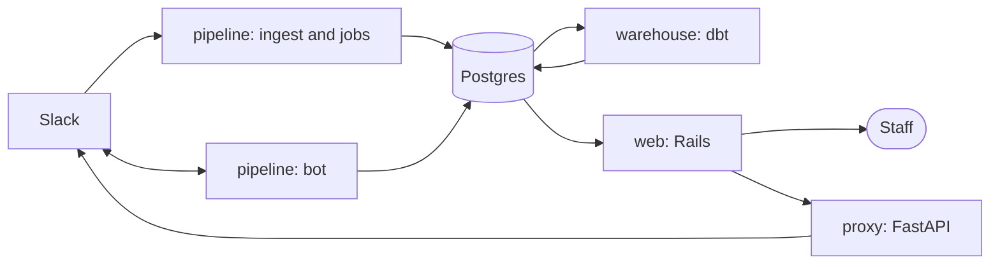

<p align="center">
  
</p>

<h1 align="center">Mnemosyne</h1>

<p align="center">Community analytics and conduct casework for Hack Club, built on Slack metadata.</p>

<p align="center">
  <a href="https://github.com/hackclub/nemo/actions/workflows/ci.yml"></a>
  <a href="./LICENSE"></a>
</p>

Mnemosyne is an internal Hack Club tool. It turns Slack metadata into community analytics and gives the fire department a place to manage reports and cases.

| | |
| --- | --- |
| **Community (nemo)** | Aggregate analytics for onboarding, replies, retention, activity and channels. |
| **Fire engine** | Cases, mirrored threads, notes, reports, actions, alt account detection and an audit trail. |

## Screenshots

<table>
  <tr>
    <th width="50%"><h3 align="center">Joining</h3></th>
    <th width="50%"><h3 align="center">Getting replies</h3></th>
  </tr>
  <tr>
    <td align="center"></td>
    <td align="center"></td>
  </tr>
  <tr>
    <th width="50%"><h3 align="center">Channels</h3></th>
    <th width="50%"><h3 align="center">Engine</h3></th>
  </tr>
  <tr>
    <td align="center"></td>
    <td align="center"></td>
  </tr>
  <tr>
    <th width="50%"><h3 align="center">Cases</h3></th>
    <th width="50%"><h3 align="center">Search</h3></th>
  </tr>
  <tr>
    <td align="center"></td>
    <td align="center"></td>
  </tr>
  <tr>
    <th width="50%"><h3 align="center">Alt accounts</h3></th>
    <th width="50%"><h3 align="center">Audit log</h3></th>
  </tr>
  <tr>
    <td align="center"></td>
    <td align="center"></td>
  </tr>
</table>

## Features

**Community**

- Member journey: joining, getting replies, coming back and who is active.
- Per-channel analytics.
- Charts built with d3.

**Fire engine**

- Cases with assignees, participants, tags, resolutions, replies, notes, actions and reversals.
- Case merges, member standing and member guards.
- Reporter conversations and mirrored Slack threads, with deep links in both directions.
- Alt account detection: links, clusters and a review queue with verdicts.
- Audit log with saved queries and CSV export.
- Slack bot: `relay` takes reports and `nemo` works them.

## Architecture



| Path | Contents |
| --- | --- |
| `web/` | Rails app: community analytics, fire engine, admin and the public API |
| `pipeline/` | Python: Slack ingestion, nightly jobs, the Slack bot and the seeder |
| `warehouse/` | dbt project: staging models and marts |
| `proxy/` | FastAPI service wrapping the Slack API clients |
| `db/` | SQL migrations and the YAML tables for capabilities, actions and flags |
| `deploy/` | Compose file and per-role env examples |

## Getting started

Requirements: Docker, Ruby, Python 3.13 with [uv](https://docs.astral.sh/uv/), and Postgres 18. `devenv.nix` provides all of them if you use [devenv](https://devenv.sh).

```sh
cp deploy/.env.example deploy/.env
```

In `deploy/.env`, set `POSTGRES_DB=mnemosyne_seed` (the seeder only writes to databases ending in `_dev`, `_test` or `_seed`) and `BOOTSTRAP_ADMIN_SLACK_ID=USEED0000001`.

```sh
(cd pipeline && uv sync)
(cd web && bundle install && bin/rails tailwindcss:build)

make up                  # Postgres
make provision           # schemas, roles, grants, migrations
make seed SCALE=dev      # synthetic community data
make serve               # http://localhost:3000
```

In development, `/dev/be/USEED0000001` signs you in as the bootstrap admin.

## Slack connection

The bot role connects to Slack in one of two modes, chosen by `SLACK_SOCKET_MODE`.

| Mode | Setting | Credentials per app | Slack app settings |
| --- | --- | --- | --- |
| Socket Mode (default, development) | unset or `true` | `NEMO_APP_TOKEN`, `RELAY_APP_TOKEN` | Socket Mode on |
| HTTP (production) | `false` | `NEMO_SIGNING_SECRET`, `RELAY_SIGNING_SECRET` | Socket Mode off, request URL on Event Subscriptions, Interactivity and each slash command |

In HTTP mode the bot listens on `SLACK_HTTP_HOST` and `SLACK_HTTP_PORT` (default `127.0.0.1:3100`; set `0.0.0.0` inside a container) and serves `POST /slack/nemo/events`, `POST /slack/relay/events` and `GET /healthz`. Terminate TLS in front of it and route only those paths to the bot.

- Every request is verified against the app's signing secret (at least 32 characters, one per app). The bot refuses to start without it.
- Request bodies over 4 MiB are refused, repeated `event_id`s are skipped, and request bodies, headers and signatures are never logged.
- User tokens (`SLACK_TOKEN`, `SLACK_ADMIN_TOKEN`) stay out of the bot environment; Slack calls that need them go through the internal proxy.

## Development

```sh
make test     # pytest and rails test
make lint     # ruff and rubocop
make doctor   # environment a role needs (ROLE=serve)
```

## Acknowledgements

- [Palantir Foundry](https://www.palantir.com/platforms/foundry/) and its [data protection and governance guidance](https://www.palantir.com/docs/foundry/security/data-protection-and-governance/) were an inspiration. Mnemosyne is independent, and Hack Club is not affiliated with Palantir.
- [d3](https://d3js.org/) for the charts.
- [Nineteen Eighty-Four](https://en.wikipedia.org/wiki/Nineteen_Eighty-Four) by George Orwell. 

## License

[MIT](./LICENSE)
